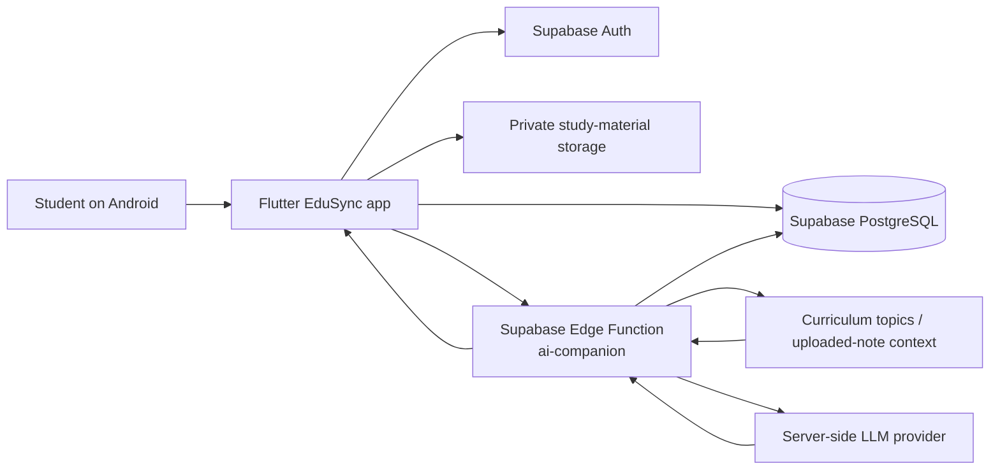

# EduSync Technical Design Document

## 1. Purpose

EduSync is an Android study companion for school and college learners in India. It personalises AI-assisted explanations, practice questions, flashcards, and uploaded-note support using each student's education level, board or degree, department, semester, subjects, medium of instruction, and learning goal.

The prototype currently supports school learners in Grades 9–12 (CBSE and Tamil Nadu State Board) and a broad set of college degrees and departments. The design allows curriculum coverage to be expanded by adding approved topics to the `curriculum_topics` table.

## 2. Primary user journey

1. A student signs up and completes either a school or college profile.
2. The app stores the profile locally and, when Supabase is configured, securely syncs it to the cloud.
3. The student asks a question, optionally referring to an uploaded note.
4. The app sends the question to a Supabase Edge Function.
5. The function verifies the user, loads the profile, matches relevant curriculum content, and calls a server-side AI provider.
6. The answer, follow-up options, and source metadata are returned to the app and saved in private chat history.

## 3. Architecture

### Component responsibilities

| Component | Responsibility |
| --- | --- |
| Flutter Android app | Sign-up, profile setup, dashboard, chat, notes, quizzes, and flashcards |
| Supabase Auth | Authenticated student sessions |
| Supabase PostgreSQL | Profiles, conversations, messages, materials, quizzes, flashcards, and limits |
| Supabase Storage | Private uploaded-note files |
| Edge Function | Profile-aware tutor request, secret protection, API integration, response handling |
| LLM provider | Generates contextual explanations; it does not directly access the database |

## 4. Data design

| Table | Purpose |
| --- | --- |
| `student_profiles` | School/college profile and learning preferences |
| `conversations` | Student chat sessions |
| `messages` | User and AI messages, source metadata, suggested actions |
| `study_materials` | Uploaded-note metadata and extracted text |
| `material_chunks` | Segmented note content used for retrieval |
| `curriculum_topics` | Approved topic context for curriculum-aware replies |
| `quizzes` | Generated quizzes and completion results |
| `flashcards` | Student flashcard decks |
| `usage_limits` | Daily free-question quota tracking |

All student-owned tables use Supabase Row Level Security. A student may only access records associated with their authenticated user ID.

## 5. AI response design

The `ai-companion` server function reads the learner profile before creating the tutor instruction. It uses grade/board for school users and degree/department/semester for college users. Relevant approved curriculum topics and uploaded-note content are added when available.

The tutor is instructed to:

- explain at the student’s level;
- prioritise registered subjects and matching curriculum context;
- answer general questions concisely if they are outside the declared syllabus;
- state uncertainty rather than inventing a source or syllabus alignment;
- support follow-up questions using recent conversation context.

API keys remain server-side in Supabase Edge Function secrets. They must never be compiled into the APK or committed to Git.

## 6. Security and privacy

- The mobile app holds only the Supabase URL and anonymous key.
- The AI key and Supabase service-role key are backend-only secrets.
- Row Level Security isolates each learner’s profile, chats, materials, quizzes, and flashcards.
- Uploads must be type- and size-validated before processing.
- The app limits free AI requests and displays clear service errors instead of empty answers.
- Only minimum learning information should be collected; school/college name is optional.

## 7. Local development and deployment

1. Copy `.env.example` to `.env` and add project-specific values locally.
2. Run `supabase/schema.sql` and `supabase/seed_data.sql` in the Supabase SQL Editor.
3. Configure Edge Function secrets and deploy `ai-companion`.
4. Run `flutter pub get`, `flutter test`, and `flutter build apk --release`.

Detailed commands are maintained in the repository README.
